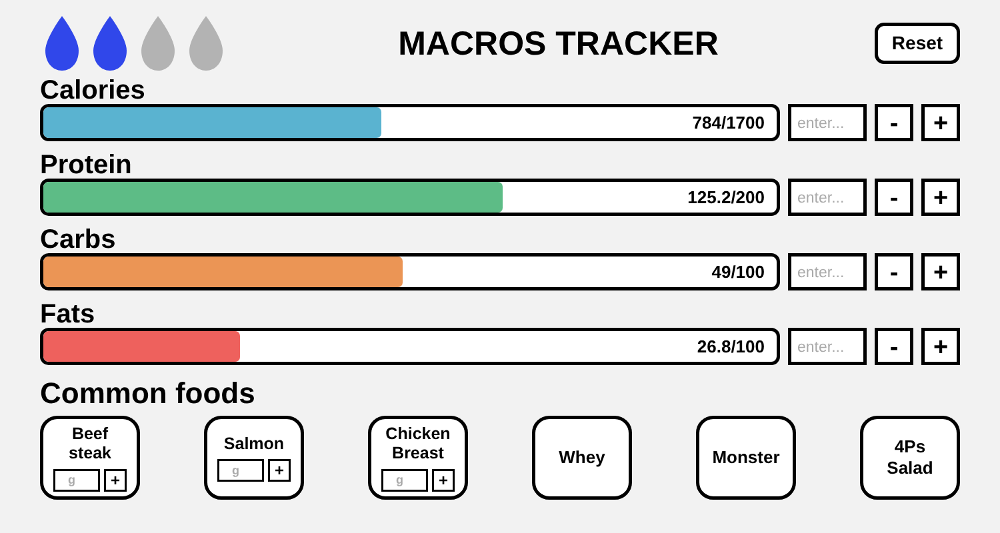
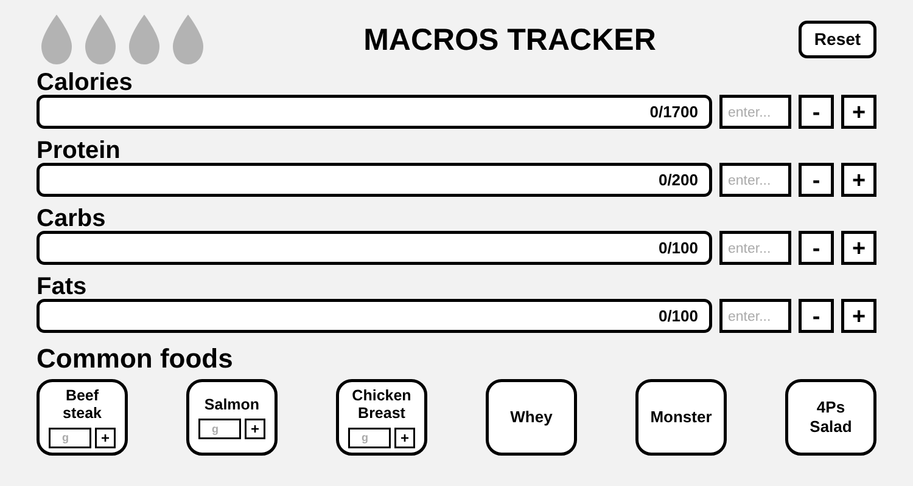

# macros_tracker

> A one-page daily tracker for calories, protein, carbs, fats and water, built around the foods I actually eat at the gym.



**Part of [phamduylong.com](https://phamduylong.com)** · `type: personal` · `status: finished`

---

## Why I built it

When I started going to the gym, I got tired of looking up the same nutrition values every day. So I built a tracker around my own targets and the foods I eat most, where adding a meal takes one click or one number.

## Before → after

| Before | After |
| --- | --- |
| Look up the same foods' macros every day and add them up by hand | Type the grams of chicken, or press **Whey**, and every bar updates |

## What it does

- **Four progress bars** for calories, protein, carbs and fats, each filling toward a daily target.
- **Manual entry** for each macro: type a number, then press **+** or **−**.
- **Weighed foods** (beef steak, salmon, chicken breast): type the grams and press **+** or Enter. The macros are scaled from per-100 g values.
- **One-tap foods** (whey, Monster, 4Ps salad): one press adds a full serving.
- **Four water droplets**, one per bottle, that you tap to fill or empty. Hover over one to see the running total in bottles and ml.
- **Reset** clears everything for a new day.

## Make it yours

Every number is a constant near the top of the `<script>` in `index.html`. The places to edit are marked with comments.

| What | Where in `index.html` | Default |
| --- | --- | --- |
| Daily targets | `new Bar("Calories", 1700)` and the three lines under it | 1700 kcal · 200 g protein · 100 g carbs · 100 g fats |
| Bottle size | `WATER_BOTTLE_ML` | 900 ml |
| Number of bottles | `WATER_BOTTLE_TARGET` | 4 |
| One-tap foods | `commonFoods` (macros per serving) | whey · Monster · 4Ps salad |
| Weighed foods | `gramFoods` (macros per 100 g) | beef steak · salmon · chicken breast |

To **add a food**, you need two edits:
1. Add an entry to `commonFoods` or `gramFoods`.
2. Add a matching button or card in the "Common foods" section of the HTML. Copy an existing one and change its name and id.

To **change the number of bottles**, add or remove a droplet button in the top row as well. `waterState` needs one `false` per bottle.

## How it works

- **One `Bar` class** holds a macro's progress and target. It handles add, subtract (never below 0) and reset.
- **Weighed foods** multiply each per-100 g value by `grams / 100` and round to one decimal before adding.
- **Each bar fills** to `progress / target`, capped at 100% so it never overflows. The label still shows the real total, so going over target stays visible.
- **No libraries, no build step and no network:** plain HTML, CSS and JavaScript in a single file.

## Built with

`HTML` · `CSS` · `JavaScript`

## Run it

```bash
git clone https://github.com/pdlong-09/macros_tracker.git
```

Then open `index.html` in any browser. That's it.

## What I learned

[Long: 2–3 sentences in your own words. For example, why you kept rebuilding the first version, or how you decided what to make one-tap.]

## Limitations

- **Nothing is saved.** Refreshing the page clears the day, the same as pressing Reset.
- **The page is a fixed 1500 × 800 layout**, made for a laptop screen. It doesn't fit phones.
- **Changing foods or bottle counts means editing the file.** There's no settings screen.

<p>
  
  
</p>

---

<sub>Phạm Duy Long · Hà Nội · [phamduylong.com](https://phamduylong.com)</sub>
